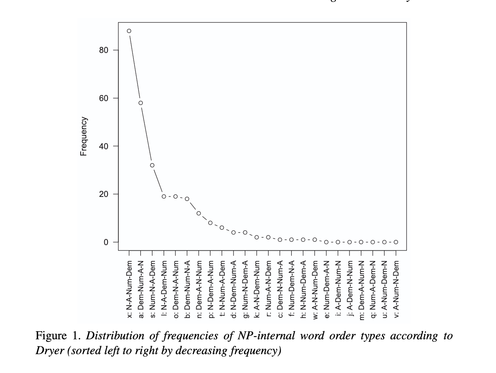

## Übersicht

-   Vorstellungsrunde
-   Informationen zum Kurs
-   Übersicht und Leistungsnachweise
-   Erwartungen
-   kurze Einführung ins Thema

## Vorstellungsrunde

-   Name (bzw. wie Du angesprochen werden willst)
-   Erfahrung mit Progammieren und Quantitativer Linguistik
-   Was ihr euch vom Kurs erhofft

## Allgemeine Informationen

-   Mittwoch, 14:00-15:30, Seminarraum links
-   Keine Sprechstunde, kontaktieren Sie mich per Email
-   Folien und Seminar auf Deutsch, Lektüre vorwiegend auf Englisch
-   Seminar im AM1/SM1:
    -   Kontaktzeit: 30/30h
    -   Selbststudium: 90/60h
- nimmt euren Laptop zu jeder Sitzung mit

## Organisatorisches

:::{.r-fit-text}

- Wir verwenden in diesem Kurs [**kein Illias**]{style="color: #8b093bf6;"}
- E-Mail-Liste
- Semesterplan, Folien und Arbeitsblätter auf einer öffentlichen Webseite: 
    - Ihre Namen & Daten werden auf der Seite nie erwähnt

:::

## Lektüre

- How to do Linguistics with R [@levshinaintro]
- Statistics for Linguists: An Introduction Using R [@winterbodo]

beide Bücher sind als Ebook über die Uni-Bib abrufbar

## Leistungsnachweise

1. **[wöchentliche Hausaufgaben]{style="color: #620d3e;"}**

- alleine oder zu zweit
- Abgabe: Dienstag vor der jeweiligen Sitzung bis 24:00
- 8/10 sind für die *aktive Teilnahme* obligatorisch
- Vorstellen/Besprechen der eigenen Lösung: zweimal während dem Semester (zufällig)
- individuelles Feedback auf Anfrage

--------------------

2. **[kleine Projektarbeit]{style="color: #620d3e;"}**

- alleine oder zu zweit
- Besprechung in Sitzung 6 oder 7 
- Abgabe vor Sitzung 12 (19.01.2027 um Mitternacht)
- gegenseitiges Vorstellen der Arbeiten: in den letzten drei Sitzungen 

## Was ich von Ihnen erwarte

**allgemein**

::: incremental
-   respektvollen Umgang, es ist mir wichtig, dass sich alle wohl fühlen
-   Unterschiede und Diversität werden als Gewinn und nicht als Nachteil betrachtet
-   Fragen sind wertvoll (d.h. es gibt keine dummen Fragen)
-   Rückmeldungen, Ideen und Anregungen eurerseits sind erwünscht
:::

## Was ich von Ihnen erwarte

Formeln zu lernen?

$$
f(t) = \frac{\Gamma (\frac{\nu + 1}{2})}{\sqrt{\nu}\Gamma(\frac{\nu}{2})}(1+\frac{t^2}{\nu})^{-(\nu + 1 )/2}
$$

## Was ich von Ihnen erwarte

Statistik und R fallen nicht allen gleich leicht und das ist in Ordnung!

:::: r-fit-text
::: incremental
- nicht entmutigen lassen und fragen, üben, fragen, üben!
  - &rarr; Hausaufgaben machen
- Die einzelnen Sitzungen bauen stark aufeinander auf. D.h. Nacharbeiten von verpassten Sitzungen ist notwendig. 
- Ebenso: Falls ihr eine Sitzung verpasst, informiert euch bei euren Kommiliton:innen, nicht alle Informationen können auf den Folien gefunden werden
:::
::::

## Was ich von Ihnen erwarte

Lust und Motivation zu Lernen
(und möglicherweise Frustrationstoleranz)

## Was ich von Ihnen erwarte

Lust und Motivation zu Lernen
(und möglicherweise Frustrationstoleranz)

&rarr; [keine Verwendung]{style="color: #a0025eea;"} von Generativen KI Chatbots (e.g. ChatGPT)

## Generative KI Chatbots

### Lernen

::: incremental
- Grundschulkinder lernen zuerst ohne Rechner, um später nachvollziehen zu können, was ein Rechner macht
- wichtiger Unterschied zum Rechner: GenKI chatbots sind *probabilistisch* und nicht *deterministisch*
:::

---------------------------

- GenKI Chatbots beruhen auf Sprachmodellen (*Large Language Models*)
- Sprachmodelle: probabilistische Modellierung von Wortsequenzen
  - Es war ... ?

---------------------------

- GenKI Chatbots beruhen auf Sprachmodellen (*Large Language Models*)
- Sprachmodelle: probabilistische Modellierung von Wortsequenzen
  - [Es war einmal]{style="color: #380322ea;"}
  - [Es war ein schöner Tag]{style="color: #2302156d;"}
  - [Es war eine Frau]{style="color: #38042227;"}
  - ...

---------------------------

- GenKI Chatbots beruhen auf Sprachmodellen (*Large Language Models*)
- Sprachmodelle: probabilistische Modellierung von Wortsequenzen **in den Trainingsdaten**

----------

- GenKI Chatbots beruhen auf Sprachmodellen (*Large Language Models*)
- Sprachmodelle: probabilistische Modellierung von Wortsequenzen **in den Trainingsdaten**
- Output von GenKI Chatbots:
  - unreproduzierbar
  - unzuverlässig (LLMs haben kein Konzept von *Wahrheit*)
  - unzitierbar (Plagiat [@rooij2022])

---------------------------

- GenKI Chatbots beruhen auf Sprachmodellen (*Large Language Models*)
- Sprachmodelle: probabilistische Modellierung von Wortsequenzen **in den Trainingsdaten**
- Output von GenKI Chatbots:
  - unreproduzierbar
  - unzuverlässig (LLMs haben kein Konzept von *Wahrheit*)
  - unzitierbar (Plagiat [@rooij2022])
- (kommerzielle) GenKI Chatbots sind aus ethischer und ökologischer Sicht problematisch [@guest2025against, @bender2025ai]

---------------------------

Zurück zum Taschenrechner und dem Lernen:

::: {style="font-size: 80%;color: #740d49cb; "}
"Using ChatGPT with R requires a good baseline knowledge of R to actually be useful. A good analogy for this is with recipes. ChatGPT is really confident at spitting out plausible-looking recipes. A few months ago, for fun, I asked it to give me a cookie recipe. I got back something with flour, eggs, sugar, and all other standard-looking ingredients, but it also said to include 3/4 cup of baking powder. That’s wild and obviously wrong, but I only knew that because I’ve made cookies before." [@heissrecipe]
::: 

---------------------------

Zurück zum Taschenrechner und dem Lernen:

::: {style="font-size: 80%;color: #740d49cb; "}
"Using ChatGPT with R requires a good baseline knowledge of R to actually be useful. A good analogy for this is with recipes. ChatGPT is really confident at spitting out plausible-looking recipes. A few months ago, for fun, I asked it to give me a cookie recipe. I got back something with flour, eggs, sugar, and all other standard-looking ingredients, but it also said to include 3/4 cup of baking powder. That’s wild and obviously wrong, but I only knew that because I’ve made cookies before." [@heissrecipe]
::: 

\+ beim Lernen ist **der Prozess** relevant und nicht das Produkt!

---------------------------

Alternativen zu GenKI Chatbots

- Code-Dokumentationen und [*Vignettes*](https://r-pkgs.org/vignettes.html)
- Online-Tutorials und Blog Posts von anderen Wissenschaftler\*innen
- Lehrbücher
- Foren wie *Stack Overflow*
- Menschen (!)
  - eure Kommiliton\*innen
  - oder ich

---------------------------

Weiterführende Lektüre zu GenKI Chatbots:

- [Chapter 15](https://elenlefoll.github.io/RstatsTextbook/15_AI.html) in @lefoll
- Themen in [Critical AI Literacies](https://evvahu.github.io/CAIL/)
- [The Bullshit Machines](https://thebullshitmachines.com/)
- @dingemanse2024

## Was erwartet ihr?

Gibt es weitere Punkte eurerseits? 

## Quantitative Linguistik

1. Wieso untersuchen wir linguistische Phänomene quantitativ? 
2. Was ist der Unterschied zwischen Theorie und Empirie?
3. Was für unterschiedliche quantiative Daten gibt es?

---------

### Beispiel: Sprachuniversalien 

Hypothese: Der Aufbau von Sprachen folgt bestimmten Universalien. 

z.B. Universalie 20 [@greenberg1963some]: 

"When any or all of the items (demonstrative, numeral, and descriptive adjective) precede the noun, they are always found in that order. If they follow, the order is either the same or its exact opposite."

---------

### Beispiel: Sprachuniversalien 

::: {style="font-size: 80%; "}

Universalie 20 [@greenberg1963some] quantitativ untersucht:

:::

{#fig-order fig-align="left"}

::: {style="font-size: 80%; "}

&rarr; die zwei häufigsten Worstellungen sind: **N-A-Num-Dem** und **Dem-Num-A-N**

:::
## Statistik

- numerisches Erfassen von einem (linguistischen) Phänonem -> Modell
- Vorhersagen treffen über mögliche Ereignisse, die wir noch nicht beobachtet haben
- Hypothesen testen

-----------------------

### Beispiel: Sprachuniversalien 

hinsichtlich der Universalie 20 [@greenberg1963some] erlaubt uns die Statistik u.a.:

- das Modellieren der Wahrscheinlichkeit einer bestimmten Wortreihenfolge über alle möglichen Sprachen hinweg (ohne dass Daten von allen Sprachen vorhanden ist)
- das Modellieren von Faktoren, die eine bestimmte Wortreihenfolge voraussagen lassen
- das Auschließen von anderen Faktoren (z.B. areale Phänomene)

-----------------------

*Deskriptive Statistik*:

- Beschreiben einer Stichprobe und übersichtliche Darstellung deren Charakteristiken
- Beispiel: Häufigkeit von unterschiedlichen Worstellungen in der Nominalphrase (siehe @fig-order)

*Inferenzstatistik*:

- auf Basis einer *Stichprobe* Aussagen über eine *Population* treffen
- Beispiel: Wahrscheinlichkeit von unterschiedlichen Worstellungen in der Nominalphrase
  - Stichprobe: 276 Sprachen in @dryer2006
  - Population: "Sprache", oder alle Sprachen der Welt

# Nächstes Mal

- Hausaufgaben: Arbeitsblatt 0 (R und RStudio installieren)
- Vorbereitung:
  - Kapitel 1 in @winterbodo
  - ["CleanItUp" by RLadies Sydney](https://rladiessydney.org/courses/02-cleanitup-0)
  - [Abschnitte 1-3 in @douglasr](https://intro2r.com/)

# Referenzen