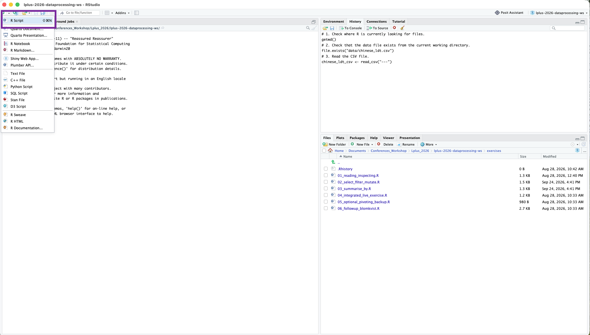

## Übersicht

Heute: einzige Sitzung in der wir uns ausschließlich mit R befassen. Danach *learning-by-doing* :-)!

## Einleitung

Konnten alle R, RStudio und Tidyverse runterladen?


## Grundlagen

### R als Taschenrechner

```{r}
#| echo: true
2 + 8
2 - 8
```

```{r}
#| echo: true
2 * 8
2 / 8
```

-----

### Logische Vergleiche

Von Zahlen ...

```{r}
#| echo: true
2 < 8
```

```{r}
#| echo: true
2 > 8
```

```{r}
#| echo: true
2 == 2
```

```{r}
#| echo: true
2 >= 2
```


--------

... oder auch von Buchstaben

```{r}
#| echo: true
"elephant" == "antelope"
```


```{r}
#| echo: true 

# `nchar()`: zählt Anzahl der Buchstaben ("Characters") in einer Zeichenfolge ("String")
nchar("elephant") == nchar("antelope") 
```

-----

### Datentypen

numeric, integer, double

logical

character(string)

-----

### Funktionen und Objekte

- R funktioniert hauptsächlich mit Funktionen (z.B. Addition `+`) und Objekten
- Wir können sowohl Funktionen als auch Objekten selber definieren. In diesem Kurs werden wir vor allem Objekte selber definieren.

Objekt kann vieles oder fast alles sein:

- Datensatz (`tibble()`)
- Zusammenfassung des Datensatzes (`summary(tibble_x)`)
- Nummern (`3`, `21234.23`,...) oder Buchstaben (`"A"`, `"Hallo wie geht es dir..."`, ...)
- Listen (`list()`) oder Vektoren (`c()`)
- ...

Jeder dieser Objekttypen kann verschiedene *Attribute* aufweisen. Z.B. können wir `nchar` auf einen *String* anwenden aber nicht auf eine Liste.

----

### Objektzuweisungen

Um ein Objekt einer *Variablen* zuzuweisen, benutzen wir `<-`:

```{r}
#| echo: true 
koelsches_grundgesetz_2 <- "Et kütt wie et kütt"
```

Was für ein Typ hat die Variable `koelsches_grundgesetz_2`?

---------


Nun können wir unsere Variable ausgeben, um zu schauen was sie beinhaltet:
```{r}
#| echo: true 
koelsches_grundgesetz_2
```

Aber das folgende Kommando spuckt einen Fehler aus, da Variabelnamen Groß-/Kleinschreibung-unterscheidend ("case-sensitive") sind.

```{r}
#| echo: true 

Koelsches_Grundgesetz_2
```

Siehe [hier](https://www.geeksforgeeks.org/r-language/r-variables/) für mehr Regeln über die Benennung von Variablen. 

----

Und wir können Variablen auch ändern:

```{r}
#| echo: true 
stringr::str_replace_all(koelsches_grundgesetz_2, "kütt", "kommt")
toupper(koelsches_grundgesetz_2)
```

----

### Funktionen

Aufbau einer Funktion

`funktion(argument)`

z.B. die Funktion `log` um den Logarithmus einer Zahl zu berechnen erfordert minimal ein Argument:

```{r}
#| echo: true 
log(3)
```

Um mehr über Funktionen zu erfahren, z.B. hier um zu erfahren, welche Basis für die Rechnung verwendet wurde können wir `help()` benutzen.
```{r}
#| echo: true 
help(log)
```


## Reproduzierbares Arbeiten

### Skripte

Wir benutzen Skripte um das, was wir programmieren, zu speichern, weiter zu verwenden und zu entwickeln und um unseren Code reproduzierbar zu machen.

Skripte können wir ganz einfach in RStudio erstellen:



Mit **#** bauen wir Kommentare in unsere Skripte ein, um unseren Code zu erklären (nicht nur für andere sondern auch für unser zukünftiges Selbst)

-----------------

### Workspace

- Wenn wir in RStudio arbeiten, werden alle Objekte normalerweise in unserem Workspace gespeichert
- Sobald wir RStudio schließen wird der Workspace automatisch gespeichert und beim nächsten Öffnen wieder geladen
- Dies ist aber nur selten wünschenswert, da unsere Skripte auch ohne den gespeicherten Workspace reproduzierbar sein sollten und öfters zu Problemen führen kann


-----------------

### Rprojects


------------


## Daten und Datenmanipulation

1. Datensatz und Skript runterladen (!TODO! ADD QR CODE)
2. Projekt erstellen
3. Skript öffnen
