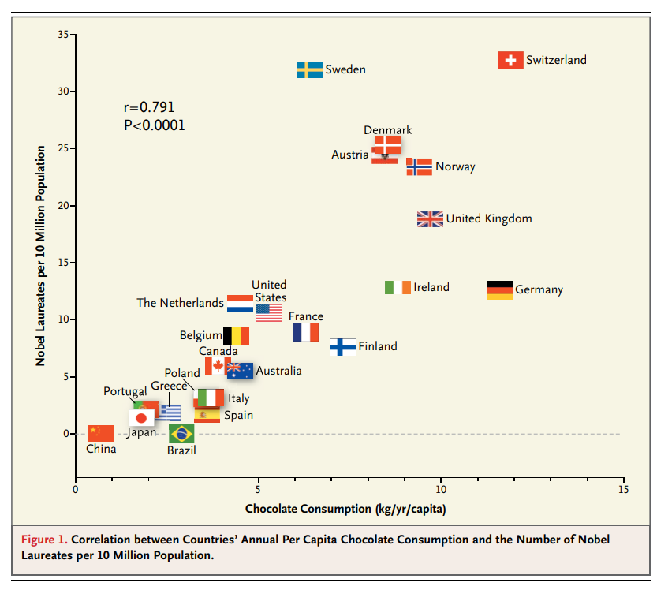
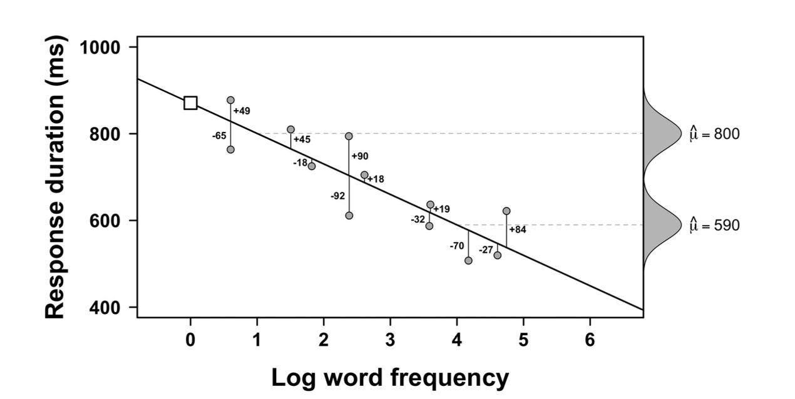
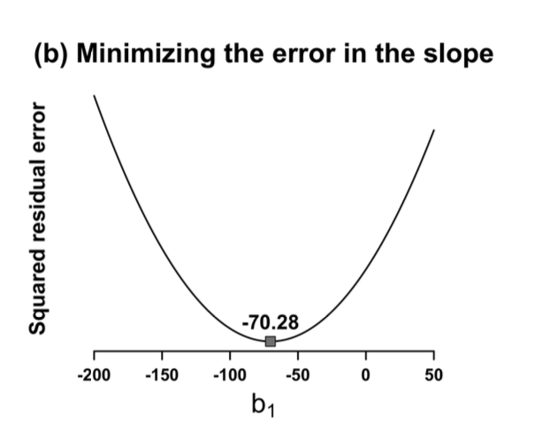

## Übersicht

1. Rückblick und Aufgabenblatt 3
2. Lineare Regression

## Rückblick

### Normalisierungsmaße

#### z-Werte (1.1 im AB3)

```{r}
#| echo: true 
library(tidyverse)
library(patchwork)
library(lme4)
rts <- read.csv('datasets/ELP_length_frequency.csv', sep=',')
mean_rt <- mean(rts$RT)
sd_rt <- sd(rts$RT)
rts <- rts |>
    mutate(z_score = (RT - mean_rt)/sd_rt)
```
```{r}
#| echo: false

wrap_plots(rts |>
    ggplot() + 
    geom_histogram(aes(x=RT), alpha=0.8, color='#088a9ec9', fill='#088a9ec9') + 
    theme_bw() + 
    labs(x='Reaktionszeit', y=''),
    rts |>
    ggplot() + 
    geom_histogram(aes(x=z_score), alpha=0.8, color='#088a9ec9', fill='#088a9ec9') + 
    theme_bw() + 
    labs(x='z-Wert der Reaktionszeit', y=''))

```


--------------------------

#### z-Werte (1.1 im AB3)

Ohne Extremwerte (z.B. behalte nur Werte mit $\text{z_score} < 2.5$ und $\text{z_score} > 2.5$):
```{r}
#| echo: true

rt_filtered <- rts |> 
    filter((z_score < 2.5) & (z_score > -2.5))

# oder:

rt_filtered <- rts |>
    filter(abs(z_score) < 2.5)

```

```{r}
#| echo: false
wrap_plots(rts |>
    mutate(filtered_out = ifelse(RT %in% rt_filtered$RT, 'False', 'True')) |>
    ggplot() + 
    geom_histogram(aes(x=RT, fill=filtered_out), color='#088a9ec9') + 
    scale_fill_manual(values = c('False' = '#088a9ec9', 'True' = '#9e0879c9')) +
    theme_bw() + 
    guides(fill = guide_legend(title = 'absolute(z-Wert) > 2.5')) + 
    labs(x='Reaktionszeit', y=''),
    rts |>
    ggplot() + 
    geom_histogram(aes(x=z_score), alpha=0.8, color='#088a9ec9', fill='#088a9ec9') + 
    geom_vline(xintercept = 2.5, linetype = "longdash", colour = '#9e0879c9') + 
    geom_vline(xintercept = -2.5, linetype = "longdash", colour = '#9e0879c9') + 
    theme_bw() + 
    labs(x='z-Wert der Reaktionszeit', y=''))

```


--------------------------

#### Wahrscheinlichkeitsberechnungen (1.2 im AB3)

Berechnungen mit `pnorm()`
```{r}
#| echo: true
pnorm(1000, mean=mean_rt, sd=sd_rt) # Wahrscheinlichkeit kleiner oder gleich 1000 ms
```

```{r}
#| echo: true
pnorm(700, mean=mean_rt, sd=sd_rt) - pnorm(600, mean=mean_rt, sd=sd_rt) # Wahrscheinlichkeit zwischen 600 und 700 ms
```

```{r}
#| echo: true
1 - pnorm(1100, mean=mean_rt, sd=sd_rt) # Wahrscheinlichkeit gleich oder größer als 1100
pnorm(1100, mean=mean_rt, sd=sd_rt, lower.tail = F) # Wahrscheinlichkeit gleich oder größer als 1100
```


--------------------------

#### Wahrscheinlichkeitsberechnungen (1.2 im AB3)

Berechnungen mit `dnorm()` (entschuldigt den Fehler!)
```{r}
#| echo: true
dnorm(600, mean = mean_rt, sd = sd_rt)
```

--------------------------

#### Wahrscheinlichkeitsberechnungen (1.2 im AB3)

Berechnungen mit `qnorm()`: 95\%-Konfidenzintervall

```{r}
#| echo: true
qnorm(0.025, mean = mean_rt, sd = sd_rt) # links
qnorm(1-0.025, mean = mean_rt, sd = sd_rt) # rechts
```

[Wie kann man das noch berechnen?]{.absolute bottom=50}

--------------------------

#### Wahrscheinlichkeitsberechnungen (1.2 im AB3)

Berechnungen mit `qnorm()`: 95\%-Konfidenzintervall


Wir wissen, dass 95\% der Daten zwischen $\bar{x}\pm (1,96 * sd)$ liegen:

```{r}
#| echo: true
mean_rt  - (1.96 * sd_rt) # links
mean_rt  + (1.96 * sd_rt) # rechts
```


```{r}
#data.frame(rt = seq(100, 1500, by=1), d = dnorm(seq(100, 1500, by=1), x=mean_rt, sd = #sd_rt)) |>
#    ggplot(aes(y = d, x = rt)) + 
#    geom_line() +
#    geom_vline(xintercept = mean_rt + (1.96*sd_rt))

```

--------------------------

## Von Univariater zu multivariater Statistik

1. Univariat: Was ist die allgemeine **Reaktionszeit** beim Erkennen Wörter von englischsprechenden Personen?
2. Multivariat: Wie beeinflusst die **Worthäufigkeit** die **Reaktionszeit** beim Erkennen von Wörtern?

```{r}
set.seed(1) 
sample <- rts |>
    sample_n(50, replace=F) |>
    filter(Word != 'windmill')
m1 <- lm(RT  ~ 1 + Log10Freq, 
        data = sample)

windmill <- rts |> filter(Word == 'windmill')
p1 <- rts |>
    ggplot(aes(x=RT)) + 
    geom_histogram(alpha=0.8, color='#088a9ec9', fill='#088a9ec9') + 
    theme_bw() + 
    labs(x='Reaktionszeit in ms)', y='')
p2 <- sample |>
    ggplot(aes(x=Log10Freq, y=RT)) + 
    geom_point(alpha=0.8, color='#088a9ec9', fill='#088a9ec9') + 
    theme_bw() +
    ggtitle('Subset (n=50) of the ELP dataset')  + 
    labs(x='log Worthäufigkeit', y='Reaktionszeit in ms')
wrap_plots(p1, p2)
```


[von *The English Lexicon Project* [@balota2007english]]{.absolute bottom=00 style="color: #5a4769ea; "}

---------------------------------

### Statistische Modelle

#### Lineare Regression

Die Linie ist unser statistisches Modell

::: incremental
- erfasst den Prozess der Reaktionszeit numerisch
- erlaubt es Vorhersagen über mögliche Ereignisse zu machen, die nicht in unserer Stichprobe sind
- erlaubt es Hypothesen zu testen
:::

```{r}
coefs <- coef(m1)
b0 <- coefs[[1]]
b1 <- coefs[[2]]
p2.ab <- p2 +
    geom_abline(intercept = b0, slope = b1, color='#9e0841c9', size = 1.5) 
p2.ab 

```

--------------------

#### Lineare Regression

Beispiel zum Vorhersagen neuer Datenpunkte:

::: {style="font-size: 80%;"}

Wie schnell wird das Wort "windmill", wessen Worthäufigkeit `r round(10^windmill$Log10Freq,2)` beträgt, erkannt?

::: incremental
- log Häufigkeit berechnen: $log_{10}(65) = 1.813$
- auf dem Graphen  y-Wert ablesen: wie viele ms beträgt y wahrscheinlich ungefähr?
:::
:::

```{r}
p2.ab +
    scale_x_continuous(breaks = c(0,1,3, 4, windmill$Log10Freq), 
            labels = scales::number_format(accuracy = 0.01, decimal.mark = ',')) + 
    scale_y_continuous(breaks = c(600, 700, 800, 900, 1000, 1100))


```

---------------------------

### Statisische Modelle

Welche Arten von Statistichen Modellen werden wir in diesem Kurs kennenlernen?

In diesem Kurs:

- parametrische Modelle
    - Annahme, dass die Daten von einer [Wahrscheinlichkeitsverteilung]{.important} mit bestimmten [Parametern]{.important} erzeugt wurden (z.B. Normalverteilung) 
    - lineare (und logistische) Regression
    - t-Tests (Inferentielle Statistik)

Nicht in diesem Kurs:

- nicht-parametrische Modelle (z.B. *Random Forests*)
- Chi-Quadrat-Test
- Varianzanalyse (*ANOVA*)

-------------------------------

### Statisische Modelle

In diesem Kurs

- "frequentistische" Ansätze für die Inferentielle Statistik 
    - *p*-Werte

Nicht in diesem Kurs:

- Bayessche Statistik


## Regression


- Ziel der Regressionsanalyse ist die Beziehung zwischen einer [Antwortvariable]{.important} (*response variable*) und einer [Prädiktorvariable]{.important} (*predictor variable*) zu modellieren
- "regressing *y* on *x*" oder "modeling *y* as a function of *x*" [@winterbodo: 69]

![[S. 70 @winterbodo]](images/variable_names.png)


Was für mögliche Antwort- und Prädiktorvariablen in gewissen linguistischen Fragestellungen kommen euch in den Sinn?

----------------


### Kausalität 

- Regression wird anhand der angenommenen [Kausalität]{.important} spezifiziert 
    - z.B. Worhäufigkeit = Prädiktorvariable (*x*) und Reaktionszeit = Antwortvariable (*y*)
- Korrelation = Kausalität?

----------------

### Kausalität 

[**Korrelation = Kausalität**]{.highlight}

::::{.columns}
:::{.column width="70%"}

:::
:::{.column width="30%"}
[Messerlis Fazit: "Chocolate consumption enhances cognitive function, which is a sine qua non for winning the Nobel Prize, and it closely correlates with the number of Nobel laureates in each country. It remains to be determined whether the consumption of chocolate is the underlying mechanism for the observed association with improved cognitive function." [@messerli2012]]{.absolute bottom=00 style="color: #5a4769ea; font-size: 70%; "}
:::
::::

## Lineare Regression

Wie unterscheiden sich jeweils die roten und türkisen Linien?

```{r}

p3 <- data.frame(x = 0:5, y=0:5) |>
ggplot(aes(x=x, y=y)) +
    geom_point(alpha=0) + 
    geom_abline(intercept = 2, slope = 0.5, color = '#9e0841c9', size=1.8, alpha=0.8,stat='identity') + 
    geom_abline(intercept = 2, slope = 0.2, color = '#089e8fc9', size=1.8, alpha=0.8, stat='identity') + 
    geom_vline(xintercept = 0, linetype = "longdash") +
    theme_bw() 
p4 <- data.frame(x = 0:5, y=0:5) |>
ggplot(aes(x=x, y=y)) +
    geom_point(alpha=0) + 
    geom_abline(intercept = 3, slope = 0.2, color = '#9e0841c9', size=1.5) + 
    geom_abline(intercept = 2, slope = 0.2, color = '#089e8fc9', size=1.5) + 
    geom_vline(xintercept = 0, linetype = "longdash") +
    theme_bw()

wrap_plots(p3, p4)
```

## Lineare Regression


Wie unterscheiden sich jeweils die roten und türkisen Linien?

- links: gleicher $y$-Achsenabschnitt (*Intercept*), andere Steigung (*slope*)
- rechts: anderer $y$-Achsenabschnitt (*Intercept*), gleiche Steigung (*slope*)
```{r}

wrap_plots(p3, p4)

```


---------------------

## Lineare Regression

Die beiden Parameter/Koeffizienten, die ein Lineares Regressionsmodell definieren:

1. *y*-Achsenabschnitt (*intercept*): der Punkt, an dem die Linie die y-Achse schneidet
2. Steigung (*slope*) $b_{1}  = \frac{\Delta y}{\Delta x}$

---------------------

### Regressionskoeffizienten

*y*-Achsenabschnitt und die Steigung sind die Koeffizienten des Modells und werden oft $b_{0}$ und $b_{1}$ genannt.

:::{.r-stack}
$y = b_{0} + b_{1} * x$
:::

[Was bedeuten der *y*-Achsenabschnitt und die Steigung?]{.absolute bottom=50}

---------------------

### Regressionskoeffizienten

::::{.columns}
:::{.column}

Wenn $y = b_{0}$:

- ist $b_{0}$ der [Mittelwert]{style="color: #ae08e0; "} (der *Mean*). 

:::
:::{.column}
```{r}
sample |>
    ggplot(aes(x=RT)) + 
    geom_density(fill = "#088a9e40",
        colour = '#088a9ec9',
                 alpha = 0.4) + 
    geom_vline(xintercept = mean(sample$RT), colour="#ae08e0",linewidth=1) +
    theme_bw() + 
    labs(x='Reaktionszeit', y='Wahrscheinlichkeitsdichte') + 
    ggtitle('Subset (n=50) of the ELP dataset') +
    xlim(min = 400, max = 1200)
```

:::
::::

---------------------

### Regressionskoeffizienten

::::{.columns}
:::{.column}
::: {style="font-size:90%; "}
Wenn $y = b_{0} + b_{1} * x$, also inklusive der Prädiktorvariable *Log10Freq*:

- ist $b_{0}$ der Mittelwert (der *Mean*) der Wenn die Worthäufigkeit (Log10Freq) 0 beträgt. 
    - [!]{.highlight} $b_{0}$ ändert sich also wenn eine Prädiktorvariable hinzugefügt wird. 
- und $b_{1}$ (Steigung) zeigt den zusätzlichen Anstieg pro einer Einheit *Log10Freq*
    - d.h.: pro einer Log10Freq sinkt die Reaktionszeit um `r round(coefs[[2]],2)`.
:::
:::

:::{.column}

```{r}

p2 +
    geom_abline(intercept = b0, slope = b1, color='#9e0841c9', size = 1.5) +
    annotate("text", x = 0.5, y=890, parse = F, label = paste('b0 = ', round(b0,2), sep=''), size=6) + 
    annotate("text", x = 1.8, y=870, parse = F, label = paste('b1 = ', round(b1, 2), sep=''), size=6) +
    geom_vline(xintercept = 0, linetype = "longdash")

```

:::

::::
::: {style="font-size:90%; "}
[Falls wir den $y$-Achsenabschnitt $b_{0}$ gerne besser interpretieren würden, könnten wir die Worthäufigkeit in z-Werte umwandeln. Wieso würde das der Interpretation dienen?]{.absolute bottom=50}
:::
---------------------

### Vorhersagen neuer Datenpunkte

::: {style="font-size: 90%;"}
Wenn wir $b_{0}$ und $b_{1}$ kennen, können wir die vorhergesagte Reaktionszeit von "windmills" direkt ausrechnen. In anderen Worten: von einem [angepaßten Modells]{.important} (*fitted model*) die [angepassten Werte]{.important} (*fitted values*) berechnen
:::


---------------------

### Vorhersagen neuer Datenpunkte

::: {style="font-size: 90%;"}
Wenn wir $b_{0}$ und $b_{1}$ kennen, können wir die vorhergesagte Reaktionszeit von "windmills" direkt ausrechnen. In anderen Worten: von einem [angepaßten Modells]{.important} (*fitted model*) die [angepassten Werte]{.important} (*fitted values*) berechnen
:::
::::{.columns}
:::{.column}
::: {style="font-size: 80%;"}
in R benutzen wir die Funktion `lm()` für simple Lineare Regressionsmodelle:
```{r}
#| echo: true 

m1 <- lm(formula = RT ~ 1 + Log10Freq, data = sample)
summary(m1)
```

der Modellzusammenfassung  entnehmen wir den y-Achsenschnittpunkt ($b_{0}$) und die Steigung ($b_{1}$)
:::
:::

:::{.column}
::: {style="font-size: 80%;"}
- Wir kennen die Häufigkeit von "windmills": 65, auf der Log-Skala: ($log_{10}(65)) = `r round(log(65, base=10),2)`)$
- $b_{0}$ und $b_{1}$ entnehmen wir dem gefitteten Modell

Also: $736.23 = `r round(m1$coefficients[[1]],2)` + `r round(m1$coefficients[[2]],2)` * `r round(log(65, base=10),2)`$
::: 
:::
::::

---------------------

### Residuen 

::::{.columns}
:::{.column}
- Fast keiner der Datenpunkte liegt perfekt auf der Regressionslinie
- *Residuen* (*residuals*) quantifizieren wie weit ein Datenpunkt von der Linie, d.h. den angepassten Werten, entfernt ist
- Demnach gilt:
    - [beobachtete Daten = angepasste Werte + Residuen]{style="font-size: 80%;"}
    - [Residuen = beobachtete Daten - angepasste Werte]{style="font-size: 80%;"}

:::
:::{.column}
```{r}
#| echo: false
p2.ab +
    scale_x_continuous(breaks = c(0,1,3, 4, windmill$Log10Freq), 
            labels = scales::number_format(accuracy = 0.01, decimal.mark = ',')) + 
    scale_y_continuous(breaks = c(600, 700, 800, 900, 1000, 1100))
```

:::
::::


------------------------

### Residuen 

Wir müssen unsere Formel also durch den Fehlerterm (*e*) ergänzen:

:::{.r-stack}
$y = b_{0} + b_{1} * x + e$
:::

-------------------

### Residuen 

Wir müssen unsere Formel also durch den Fehlerterm (*e*) ergänzen:

:::{.r-stack}
$y = b_{0} + b_{1} * x + e$
:::

::::{.columns}
:::{.column}
Das kennt ihr bereits:

- Die Wahrscheinlichkeitsdichteverteilung rechts ist nichts anderes als $y = b_{0} + e$
- Unser Mittelwert ist `r round(mean(sample$RT), 2)`, aber daneben befinden sich ganz viele Datenpunkte die von diesem Mittelwert abweichen 
- ohne $e$ wäre unsere Gleichung also falsch

:::

:::{.column}
```{r}
sample |>
    ggplot(aes(x=RT)) + 
    geom_density(fill = "#088a9e40",
        colour = '#088a9ec9',
                 alpha = 0.4) + 
    geom_vline(xintercept = mean(sample$RT), colour="#ae08e0",linewidth=1) +
    theme_bw() + 
    labs(x='Reaktionszeit', y='Wahrscheinlichkeitsdichte') + 
    ggtitle('Subset (n=50) of the ELP dataset') +
    xlim(min = 500, max = 1200)


```
:::
::::

------------------------

### Residuen 

Wir müssen unsere Formel also durch den Fehlerterm (*e*) ergänzen:

:::{.r-stack}
$y = b_{0} + b_{1} * x + e$
:::

::::{.columns}
:::{.column}

- Das Gleiche mit einer Prädiktorvariable $y = b_{0} + b_{1} * x + e$
- Auf jedem Abschnitt der Linie (kann man sich vorstellen als Mittelwert von Reaktionszeit abhängig von einer spezifischen Worthäufigkeit) gibt es Streuung

:::

:::{.column}
```{r}
p2.ab +
    scale_x_continuous(breaks = c(0,1,3, 4, windmill$Log10Freq), 
            labels = scales::number_format(accuracy = 0.01, decimal.mark = ',')) + 
    scale_y_continuous(breaks = c(600, 700, 800, 900, 1000, 1100))


```


:::
::::
---------------------

### Evaluieren der Modellanpassung

- Anhand der Residuen können wir berechnen, wie gut das Modell auf die Werte angepasst ist (*goodness of fit*)
- Summe der Abweichungsquadrate (*sum of squared errors (SSE)*): $SSE = \sum_{i=1}^{n}(y_{i}-f(x_{i}))^2$



---------------------

### Evaluieren der Modellanpassung

- Anhand der Residuen können wir berechnen, wie gut das Modell auf die Werte angepasst ist (*goodness of fit*)
- Summe der Abweichungsquadrate (*sum of squared errors (SSE)*): $SSE = \sum_{i=1}^{n}(y_{i}-f(x_{i}))^2$
- Der SSE alleine ist noch nicht wirklich hilfreich.
- Oftmals vergleichen wir den SSE des Modells mit einem anderen Modell
    - z.B. dem [leeren Modell]{.important} (*intercept-only model*), also $y = b_{0}$
- das gibt uns das [Bestimmtheitsmaß]{.important} ($R^2$)  
    - $R^2 = 1 - \frac{SSE_{model}}{SSE_{null}}$


---------------------

### Evaluieren der Modellanpassung

$R^2 = 1 - \frac{SSE_{model}}{SSE_{null}}$


```{r}
#| echo: true
m1 <- lm(formula = RT ~ 1 + Log10Freq, data = sample) # Modell mit Worthäufigkeit als Prädiktorvariable
m1.null <- lm(formula = RT ~ 1, data = sample) # leeres Modell, enthält nur den y-Achsenabschnitt
```

Nun rechnen wir den $R^2$ aus: 

```{r}
#| echo: true 
sse <- sum((fitted(m1) - sample$RT)^2)
sse.null <- sum((fitted(m1.null) - sample$RT)^2)

r_squared <- 1 - (sse/sse.null)
r_squared

```

- Der  $R^2$ zeigt wie viel Varianz in den Daten durch das Modell erfasst wird. 
- Hier sind `r round(r_squared, 2)*100`\% durch das Einfügen des Prädiktors Worthäufigkeit der Varianz erfasst, `r 100 - round(r_squared, 2)*100`\% bleiben unerfasst. 
- Der  $R^2$ ist des Weiteren ein Maß für die [Effektgröße]{.important} (*effect size*)
- Die Effektgröße misst wie stark zwei Variablen voneinander abhängen
- Wir werden noch weitere Effektgrößen im Verlauf des Kurses kennenlernen

---------------------


### Modellanpassung

#### Wie kriegen wir eigentlich die Koeffizienten $b_{0}$ und $b_{1}$?

::::{.columns}
:::{.column width="60%"}
- &rarr; Minimisieren der quadrierten Residuen 
    - [$(y_{i}-f(x_{i}))^2$, den Unterschied zwischen den vorhergesagten/angepassten Werten und den beobachteten Werten, also den Datenpunkten]{style="font-size: 80%; "}
- wird im Hintergrund durch die Funktion lm() ausgeführt
- Der Vorgang wird deshalb auch *least squares regression* genannt
:::
:::{.column width="40%"}

:::
::::
---------------------

### Modelloutput

- `Std. Error`,  `t value` und  `Pr(>|t|)` nach den Weihnachtsferien (*inferentielle Statistik*): ist Worthäufigkeit "signifikant"?

## Lernziele

- die Koeffizienten, $y$-Achsenabschnitt (*intercept*) und Steigung (*slope*), einer Linearen Regression kennen und wissen, was sie bedeuten
- wissen, wie man anhand eines angepassten Regressionsmodell, Voraussagen über neue Werte machen kann
- wissen, was Residuen (*resdiuals*) sind und wie man sie berechnet
- wissen, wie man anhand der Residuen die Summe der Abweichungsquadrate (*sum of squared errors (SSE)*) berechnet 
- das Bestimmtheitsmaß ($R^2$) kennen, wissen wie es berechnet wird und was es bedeutet


## Nächstes Mal

- Arbeitsblatt 4
- Multiple Lineare Regression (und Interaktionen)
- Projektarbeit 

## Referenzen


