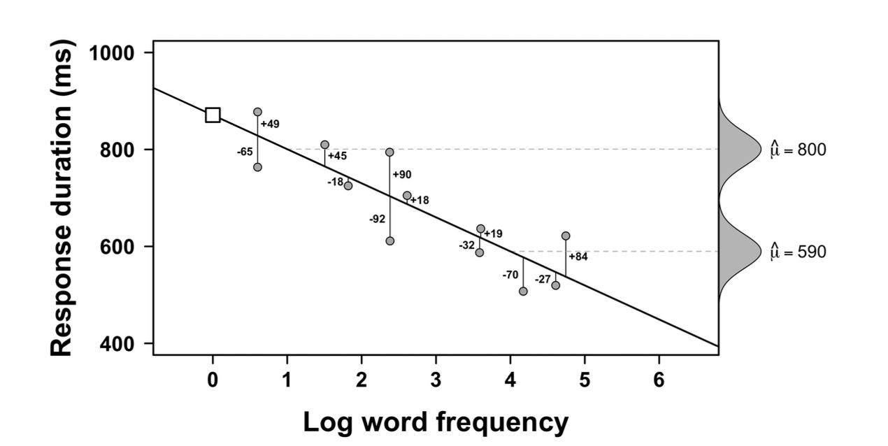
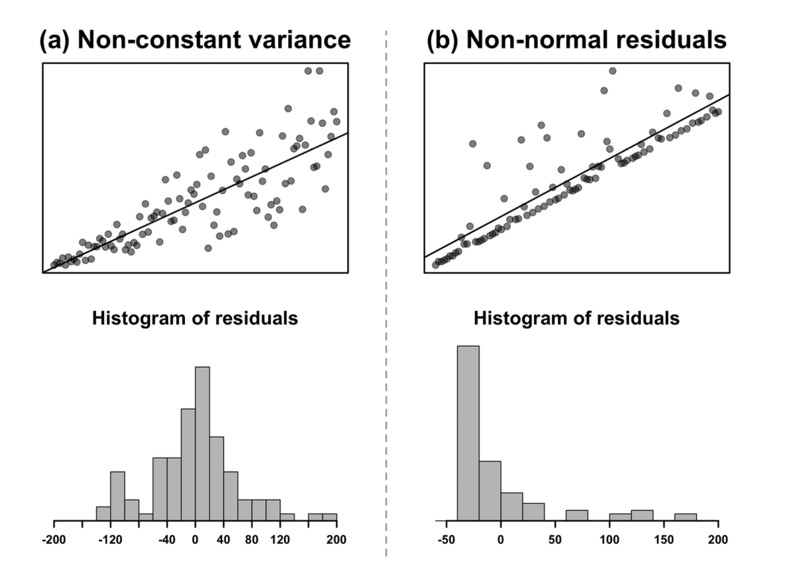

## Übersicht

1. Rückblick und Aufgabenblatt 4
2. Multiple Lineare Regression
3. kategoriale Prädiktorvariablen (*verschoben auf Sitzung 7)
4. Projektarbeit

## Rückblick

### Lineare Regression

```{r}
library(tidyverse)
library(broom)
library(patchwork)
```

Die beiden Parameter/Koeffizienten, die ein Lineares Regressionsmodell definieren:

1. *y*-Achsenabschnitt (*intercept*): der Punkt, an dem die Linie die y-Achse schneidet
2. Steigung (*slope*) $b_{1}  = \frac{\Delta y}{\Delta x}$

```{r}
p3 <- data.frame(x = 0:5, y=0:5) |>
ggplot(aes(x=x, y=y)) +
    geom_point(alpha=0) + 
    geom_abline(intercept = 2, slope = 0.5, color = '#9e0841c9', size=1.8, alpha=0.8,stat='identity') + 
    geom_abline(intercept = 2, slope = 0.2, color = '#089e8fc9', size=1.8, alpha=0.8, stat='identity') + 
    geom_vline(xintercept = 0, linetype = "longdash") +
    theme_bw() 
p4 <- data.frame(x = 0:5, y=0:5) |>
ggplot(aes(x=x, y=y)) +
    geom_point(alpha=0) + 
    geom_abline(intercept = 3, slope = 0.2, color = '#9e0841c9', size=1.5) + 
    geom_abline(intercept = 2, slope = 0.2, color = '#089e8fc9', size=1.5) + 
    geom_vline(xintercept = 0, linetype = "longdash") +
    theme_bw()

wrap_plots(p3, p4)


```


Ausschreiben der allgemeinen Formel:

:::{.r-stack}
$y = b_{0} + b_{1} * x$
:::

------------------------------------

### Koeffizienten

::: incremental
- Was bedeutet $b_{0}$ in dem folgenden Modell: $y = b_{0}$ (dem "leeren Modell")?
- Was bedeutet $b_{0}$ in diesem Modell: $y = b_{0} + b_{1} * x$?
- und was bedeutet $b_{1}$?
:::


::: {.notes}
- b_{0} in 1 = Mittelwert
- ist $b_{0}$ der Mittelwert (der *Mean*) der Wenn die Worthäufigkeit (Log10Freq) 0 beträgt. 
    - [!]{.highlight} $b_{0}$ ändert sich also wenn eine Prädiktorvariable hinzugefügt wird. 
- und $b_{1}$ (Steigung) zeigt den zusätzlichen Anstieg pro einer Einheit *Log10Freq*
    - d.h.: pro einer Log10Freq sinkt die Reaktionszeit um .
:::

------------------------------------

### Residuen


::: incremental
- Was sind Residuen? 
- Funktion wird deshalb durch den Fehlerterm *e* ergänzt: $y = b_{0} + b_{1} * x + e$
:::




::: {.notes}
Residuen (residuals) quantifizieren wie weit ein Datenpunkt von der Linie, d.h. den angepassten Werten, entfernt ist

Residuen = beobachtete Daten - angepasste Werte

:::

------------------------------------


### $R^{2}$

Was zeigt uns der $R^{2}$?

::: incremental
- Summe der Abweichungsquadrate (*sum of squared errors (SSE)*): $SSE = \sum_{i=1}^{n}(y_{i}-f(x_{i}))^2$
- Vergleich mit einem *leeren Modell* gibt uns das [Bestimmtheitsmaß]{.important} ($R^2$)  
    - $R^2 = 1 - \frac{SSE_{model}}{SSE_{null}}$
:::

::: {.notes}
Der  $R^2$ zeigt wie viel Varianz in den Daten durch das Modell erfasst wird. 
:::


## Aufgabenblatt 4

```{r}
#| echo: false
library(tidyverse)


word_rts <- read.csv('datasets/ELP_frequency.csv', sep='\t')


m1 <- lm(RT ~ 1 + Log10Freq, data = word_rts)
m2 <- lm(log(RT,base=10) ~ 1 + Log10Freq, data = word_rts)

```


```{r}
#| echo: true

m1$coefficients # ms-Scale
m2$coefficients # log-Scale

```

------------------------------------------

### Backtransform (3.2)

```{r}
#| echo: true
tidy(m2$coefficients) |>
    mutate(ms = 10 ^ x)
```


::: {style="font-size:80%; "}

*Intercept* des zweiten Modells unterscheidet sich leicht von dem *Intercept* des ersten Modells. 


Interpretation:

- Intercept: vorhergesagte Reaktionszeit bei einer Worthäufigkeit von 1 ($log_{10}(0) = 1)$)
- Steigung:
    - Modell 1: zeigt den zusätzlichen Anstieg in Reaktionszeit pro einer Einheit *Log10Freq* ($log_{10}(1) = 10)$)
    - Modell 2: zeigt auch den zusätzlichen Anstieg in log-Reaktionszeit einer Einheit *Log10Freq* ($log_{10}(1) = 10)$)
        - wenn wir die Steigung potenzieren ($10^(\beta_{1}$)), ändert sich die ursprüngliche Bedeutung
        - Stattdessen: Wie viele Prozente sich die Reaktionszeit verringert wenn eine Worthäufigkeit sich um 10 ändert
        - es wird normalerweise empfohlen nur den *Intercept* umzurechnen

:::

------------------------------------------

### Vorhersagen treffen

```{r}
#| echo: true
b0_m1 <- m1$coefficients[[1]]
b1_m1 <- m1$coefficients[[2]]

b0_m2 <- m2$coefficients[[1]]
b1_m2 <- m2$coefficients[[2]]


rt <- b0_m1 + b1_m1 * 3
rt_log <- b0_m2 + b1_m2 * 3

rt
10^rt_log

```


------------------------------------------

### Andere Transformationen

:::: {.columns}


::: {.column}

**Z-Werte**
```{r}
#| echo: true

word_rts <- word_rts |>
    mutate(z_score = (RT - mean(word_rts$RT))/ sd(word_rts$RT))

m3 <- lm(z_score ~ 1 + Log10Freq, data = word_rts)
summary(m3)
```

:::
::: {.column}

**Zentrierte Werte**


```{r}
#| echo: true
word_rts <- word_rts |>
    mutate(rt_c = RT - mean(word_rts$RT))

m4 <- lm(rt_c ~ 1 + Log10Freq, data = word_rts)
summary(m4)

```

[Gleiche Steigung wie im ersten Modell!]{style="font-size: 80%; "}

:::
::::


## Multiple lineare Regression

von einer zu mehreren Prädiktorvariablen

$y = b_{0} + b_{1}x + b_{2}x + ...+ e$

```{r}
#| echo: false
# von https://www.geeksforgeeks.org/r-language/how-to-plot-3d-scatter-diagram-using-ggplot-in-r/


library(plotly)

data <- data.frame(
  x = rnorm(100),
  y = rnorm(100),
  z = rnorm(100)
)

p <- plot_ly(data, x = ~x, y = ~y, z = ~z, type = "scatter3d", mode = "markers",
                  marker = list(size = 3)) %>%
  layout(title = "Drei Variablen",
         scene = list(xaxis = list(title = "X Axis"),
                      yaxis = list(title = "Y Axis"),
                      zaxis = list(title = "Z Axis")))
p
```

&rarr; mehr als nur einen Steigungskoeffizienten

------------

### Multiple lineare Regression

Reaktionszeit: Worthäufigkeit und Wortlänge?

```{r}
#| echo: false
rts <- read.csv('datasets/ELP_length_frequency.csv', sep=',') |>
    mutate(log_rt = log(RT, base=10))
```


```{r}
#| echo: false
rts |>
    ggplot(aes(x=Log10Freq, y=RT, color=length, alpha=0.7)) + 
    geom_point() + 
    scale_colour_continuous(palette = c("#f1a94bec","#550683")) + 
    guides(alpha = "none", color=guide_legend(title = "Wortlänge")) + 
    labs(x='log Worthäufigkeit', y='Reaktionszeit in ms') +
    theme_bw()
```

------------

### Multiple lineare Regression

Reaktionszeit: Worthäufigkeit und Wortlänge?


::::{.columns}
:::{.column}
$y = b_{0} + b_{1}\text{Log10Freq} + e$
```{r}
#| echo: true
m1.freq <- lm(log_rt ~ 1 + Log10Freq, data=rts)
summary(m1.freq)
```
:::
:::{.column}
$y = b_{0} + b_{1}\text{Log10Freq} + b_{2}\text{Wortlänge} + e$
```{r}
#| echo: true
m2.freq <- lm(log_rt ~ 1 + Log10Freq + length, data=rts)
summary(m2.freq)
```

:::
::::

Mit der Prädiktorvariable *Wortlänge* ist der $R^{2}$ von `r round(glance(m1.freq)$r.squared,2)` auf `r round(glance(m2.freq)$r.squared,2)` gestiegen. Wieso?

------------

### Multiple lineare Regression

Was hat sich sonst noch verändert?

::: {.incremental}
- der *y*-Achsenabschnitt
    - *y*-Achsenabschnitt zeigt nun den vorhergesagten Wert wenn *log10Freq* = 0 und *length* = 0
- $b_{1}$, der Koeffizient der Worthäufigkeit 
    - d.h. der Effekt von Worthäufigkeit wurde durch das Einfügen einer weiteren Prädiktorvariable verringert
    - und war vermutlich durch den Einfluss von Wortlänge "konfundiert"
:::

------------


### Multiple lineare Regression

Was zeigen die Koeffizienten?

- Jeder Koeffizient stellt eine "Teilregression" (*partial regression*) dar, der gemessen wird während die anderen Koeffizienten konstant gehalten wird
- $b_{1}$ zeigt also den Einfluss der Worthäufigkeit, wenn die Wortlänge konstant gehalten wird
- Das erlaubt uns die Effekte von unterschiedlichen Prädiktoren zu schätzen und auseinanderzuhalten 


$y = b_{0} + b_{1}\text{Log10Freq} + b_{2} * \text{Wortlänge} + e$

------------

### Multiple lineare Regression

Unsere angepassten Koeffizienten auf zwei Dezimalstellen gerundet:
```{r}
round(m2.freq$coefficients,2)
```

$\text{log RT} = 2,87 + -0,04* \times \text{Log10Freq} + 0,01 \times \text{Wortlänge}$ 

------------

### Multiple lineare Regression

Unsere angepassten Koeffizienten auf zwei Dezimalstellen gerundet:
```{r}
round(m2.freq$coefficients,2)
```

$\text{log RT} = 2,87 + -0,04* \times \text{Log10Freq} + 0,01 \times \text{Wortlänge}$ 


#### Beispiele

::: {style="font-size: 80%;"}

fiktives Wort *sabi* mit Worthäufigkeit 14 ($log_{10}(14) = `r round(log(14, base=10),2)`$) und Wortlänge 14

- $2.864 = 2,87 + -0,04*1,15 + 0,01 * 4$ 
- $2.864 = 2,87 + -0.046 + 0.04$ 

fiktives Wort *pagsasabihan* mit Worthäufigkeit 14 ($log_{10}(14) = `r round(log(14, base=10),2)`$

- $rt = 2,87 + -0,04*1,15 + 0,01 * 12$ 
- $2.944 = 2,87 + -0.046 + 0.12$ 


die vorhergesagte Reaktionszeit unterscheidet sich um 0.08 \text{log RT} zwischen den beiden fiktiven Wörtern, was `r round(10^0.08, 2)`ms entspricht. 

:::

## Adjusted $R^{2}$

In der Modellzusammenfassung in `R` wird sowohl der $R^{2}$ wie auch der $Adjusted R^{2}$ angegeben

```{r}
summary(m2.freq)
```

::: {style="font-size: 80%;"}

- der *Adjusted $R^{2}$* misst genauso, wie gut die Prädiktorvariablen die Antwortvariable vorhersagt
- der *Adjusted $R^{2}$* ist aber ein konservativeres Maß als der $R^{2}$ weil er ein *penalizing term* enthält, der die Anzahl an Prädiktorvariablen miteinbezieht
- verhindert [*Overfitting*]{.important}

::: 

## Lineare Regression: Anforderungen

1. Normalität und Homoskedastizität der Residuen
2. Kollinearität 

---------------------

### Normalität und Homoskedastizität der Residuen

Wir nehmen an, dass die Residuen normalverteilt ([Normalität]{.important}) sind und dass ihre Varianz konstant ist ([Homoskedastizität]{.important})




---------------------

### Normalität und Homoskedastizität der Residuen

In unserem Modell (*Reaktionszeit ~ Wortlänge + Worthäufigkeit*)

```{r}
library(patchwork)

residuals <- data.frame(res = m2.freq$residuals, val = m2.freq$fitted.values)

wrap_plots(
residuals |>
    ggplot(aes(x=res)) + 
    geom_histogram(binwidth = 0.01, alpha=0.8) + 
    ggtitle('Histogramm') + 
    theme_bw(),

residuals |>
    ggplot() + 
  aes(sample = res) + 
  geom_point(stat='qq') + 
  ggtitle('Q-Q Plot') + 
  stat_qq_line(),

residuals |>
ggplot(aes(x=val, y=res)) + 
  geom_point(alpha=0.3)  + 
  ggtitle('Residuenplot') + 
    theme_bw())
```


-------------------------

### Kollinearität 

- Wenn zwei oder mehrere Prädiktorvariablen (fast) die gleiche Information enthalten, sprechen wir von [Kollinearität]{.important}
- Problem: Modellanpassung ist erschwert, da es schwierig ist rauszufinden, welcher Variable ein Effekt zugeordnet werden soll
- Kollinearität untergräbt so die Modellinterpretation, aber nicht unbedingt die Modellanpassung für das Vorhersagen neuer Daten

-------------------------

### Kollinearität 

#### Beispiel aus @winterbodo, p.113 : 

::: {style="font-size: 85%;"}

Zuerst passen wir ein Modell ($b_{0} = 10$, $b_{1} = 3$) mit zufallsgenerierten Daten an:
```{r}
#| echo: true
x <- rnorm(50)
y <- 10 + 3*x + rnorm(50)

tidy(lm(y ~ 1 + x)) |> select(term, estimate)
```

:::

-------------------------

### Kollinearität 

#### Beispiel aus @winterbodo, p.113 : 

::: {style="font-size: 85%;"}

Zuerst passen wir ein Modell ($b_{0} = 10$, $b_{1} = 3$) mit zufallsgenerierten Daten an:
```{r}
#| echo: true
x <- rnorm(50)
y <- 10 + 3*x + rnorm(50)

tidy(lm(y ~ 1 + x)) |> select(term, estimate)
```


Nun fügen wir eine weitere Prädiktorvariable mit fast den genau gleichen Werten hinzu:

```{r}
#| echo: true
x2 <- x
x2[30] <- -1
x2[50] <- 2

cor(x, x2)

tidy(lm(y ~ 1 + x + x2)) |> select(term, estimate)
```

:::


--------------


### Kollinearität 

#### Beispiel aus @winterbodo, p.113 : 


In R können wir vom Package `car` die Funktion `vif()` benutzen um die *variance inflation factors* zu berechnen. *Variance inflation factors* berechnen wie stark eine Prädiktorvariable durch eine andere erfasst werden kann. 

```{r}
#| echo: true
library(car)

vif(lm(y ~ 1 + x + x2))

```

Unterschiedliche Empfehlungen, ab wann ein *vif* problematisch ist.
Einige sagen ab 10, andere 3-4 [@winterbodo].


## Projektarbeit

Ziel: Eigenständig das Gelernte an einem "echten" Datensatz umsetzen

Das heißt:

::: incremental

1. Daten einlesen
2. deskriptiver Überblick über die Daten
3. Modellanpassung
4. Modellinterpretation

:::

---------------------

### 1. Daten 

**Option 1**: Zwei Datensätze, aus publizierten Artikeln:

- Word choice is coupled with grammar: The case of kinship [@barth2026] (binär, kategorische Antwortvariable)
- Everyday language input and production in 1,001 children from six continents [@bergelson2023] (numerisch, kontinuierliche Antwortvariable)

Mehr Informationen findet ihr im Dokument [Projektarbeit.pdf](Projektarbeit.pdf)

**Option 2**: Datensatz eurer Wahl

Antwortvariable sollte kategorisch (binär) oder numerisch sein

**Option 3**: Datensatz aus @winterbodo oder @levshinaintro

Außer die Datensätze, die wir im Unterricht schon benutzt haben. 


---------------------

### 2. deskriptiver Überblick über die Daten

- Beschreibung der Variablen im Datenset
- deskriptive Übersicht deren

---------------------

### 3. Modellanpassung

- Modell (lineare oder logistische Regression) und die Prädiktorvariablen sowie deren Kodierung (*contrast coding*) oder Skala (normalisiert oder nicht) wählen 
- Modellannahmen prüfen (Normalität, Kollinearität und Homoskedaszität)

### 4. Modellinterpretation

- Wie sind die geschätzten Koeffizienten und wie können sie interpretiert werden?
- Welcher Effekt ist am stärksten?
- ...

## Projektarbeit

### Informationen

::: {style="font-size: 85%;"}

- alleine oder in Gruppen bis max. 3 Personen
- Abgabe: 
    - Format: R-Skript und zusätzlicher Bericht (Stichpunkte reichen) mit Begründung für das gewählte Modell und die Resultate (inkl. Interpretation)
    - Termin: 26.1.2026
- In der letzten Sitzung vor Weihnachten (16.12.2026) könnt ihr an eurem Projekt arbeiten und Fragen stellen. 
- Einige Aufgabenblätter dienen der weiteren Vorbereitung der Projektarbeit
    - z.B. auf nächste Woche: Datensatz auswählen

:::

Fragen?

## Nächstes Mal

- "Arbeitsblatt 5"
- Interaktionen und Logistische Regression
- Modulprüfung

# Lernziele


# Referenzen


